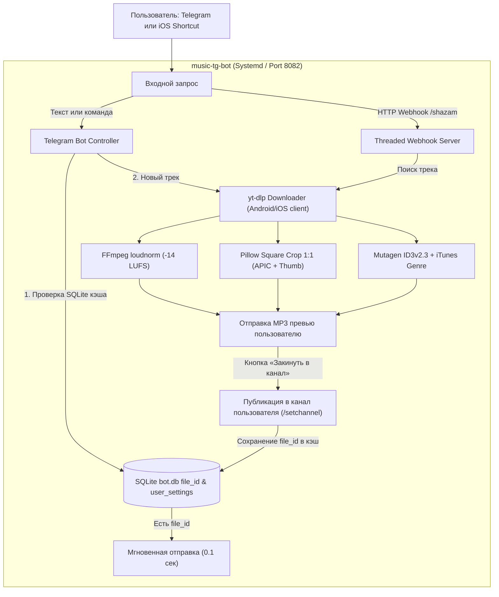

# 🎵 Telegram Music Bot & Downloader 2.0

[](https://www.python.org/downloads/)
[](https://github.com/yt-dlp/yt-dlp)
[](https://python-pillow.org/)
[](LICENSE)

Модульный, высокопроизводительный Telegram-бот для поиска, нормализации звука, скачивания музыки в высоком качестве (MP3 320 kbps) и автоматической публикации в каналы и группы. Включает обход блокировок YouTube (HTTP 403 / 18+ Age Gate), мгновенный кэш `file_id` в SQLite (0.1 сек), 100% возврат квадратных обложек треков (Pillow + ID3 APIC), нормализацию громкости (EBU R128), слова песен, выбор альтернативных версий, многопользовательскую привязку каналов и Webhook API для **Apple Быстрых команд (Shazam)**.

---

## ✨ Основные возможности 2.0

1. **⚡ Мгновенная отправка из кэша (0.1 сек)**:
   - Встроенная SQLite база данных `data/bot.db` сохраняет `file_id` Telegram всех отправленных и опубликованных треков.
   - При повторном запросе трека он отдается мгновенно без повторного скачивания с YouTube/SoundCloud.
2. **👥 Многопользовательский режим и персональные каналы (`/setchannel`)**:
   - Любой пользователь или группа может привязать свой собственный канал/группу для отправки треков по кнопке «Закинуть в канал».
   - Поддержка как публичных `@username_канала`, так и приватных ID `-100xxxxxxxxxx` с автоматической верификацией прав администратора.
3. **🗄️ Настраиваемый срок хранения кэша и автоочистка**:
   - Конфигурируемое время жизни временных MP3 на диске (`TEMP_EXPIRATION_SECONDS` / `CACHE_EXPIRATION_HOURS`) и срок хранения записей в SQLite (`CACHE_EXPIRATION_DAYS`).
   - Фоновый процесс автоматически очищает диск каждые 15 минут без остановки сервиса.
4. **🖼 100% восстановление обложек треков (Cover Art Engine)**:
   - Автоматический перехват обложек любого формата (`.webp`, `.jpg`, `.png`, `.jfif`) из YouTube и SoundCloud.
   - Квадратный центрированный кроп 1:1 с помощью **Pillow**:
     - `cover.jpg` (600x600, JPEG 92%) — вшивается в ID3v2.3 `APIC` фрейм MP3 (отображается в плеере iOS, Android, macOS и Telegram Desktop).
     - `thumb.jpg` (320x320, JPEG <200 КБ) — передается как Telegram `thumbnail` для красивой превью-карточки трека в сообщении.
5. **🔊 Автоматическая нормализация громкости (EBU R128)**:
   - Аудиофильтр FFmpeg `loudnorm=I=-14:TP=-1.5:LRA=11` приводит все треки к единому стандарту стриминговых сервисов (-14 LUFS). Никаких оглушающих или чересчур тихих треков.
6. **🔀 Выбор альтернативных версий (`🔀 Другие версии`)**:
   - Кнопка под предпросмотром находит топ-3 альтернативных версии на YouTube (Remix, Live, Acoustic, Extended) и позволяет скачать любую из них в один клик.
7. **📝 Текст песни (`📝 Текст песни` / `/lyrics`)**:
   - Мгновенное получение текста песни из открытой базы LRCLIB API с выводом слов прямо в чат Telegram.
8. **🏷 Умные хэштеги жанров**:
   - Определение жанра через iTunes Search API с автоматическим добавлением тематических тегов (`#музыка #hiphop #rap`, `#rock`, `#electronic`, `#pop` и др.) в публикации канала.
9. **✏️ Редактирование тегов на лету (`✏️ Изменить теги`)**:
   - Возможность исправить исполнителя и название трека перед отправкой в канал. Бот перезаписывает ID3-теги файла через mutagen.
10. **🔗 Распознавание прямых ссылок**:
    - Поддержка ссылок на треки из **Spotify**, **Яндекс Музыки**, **Apple Music**, **SoundCloud** и **YouTube**.
11. **📂 Пакетное скачивание альбомов и плейлистов (`/album <link>`)**:
    - Извлечение треков из плейлистов YouTube и пакетная загрузка в очередь.
12. **🛡 Обход блокировок и 18+ YouTube**:
    - Использование клиентов Android и iOS в `yt-dlp`, предотвращающее `HTTP 403 Forbidden` и обходящее `Sign in to confirm your age` без экспорта cookies браузера.
    - Автоматический фоллбэк на SoundCloud при блокировках.
13. **⚡ Неблокирующая архитектура (`ThreadPoolExecutor`)**:
    - Загрузки и конвертации выполняются в пуле фоновых потоков; бот и вебхук мгновенно реагируют на любые действия.
14. **📱 Интеграция с Apple Командами (Shazam Webhook)**:
    - HTTP Webhook сервер (`/shazam` и `/music`, `GET`/`POST`) с авторизацией по токену для отправки треков с iPhone в один тап.

---

## 🕹 Команды Telegram-бота

| Команда | Описание |
| :--- | :--- |
| `/music <название>` | Поиск и скачивание трека (MP3 320 kbps, обложка 1:1, EBU R128) |
| `/album <ссылка>` | Пакетный парсинг и загрузка плейлиста или альбома YouTube |
| `/lyrics <трек>` | Поиск и отображение текста песни из LRCLIB |
| `/setchannel <@канал или ID>` | Привязать целевой канал или группу для публикации музыки |
| `/mychannel` | Показать текущий привязанный канал |
| `/clearchannel` | Сбросить привязку канала |
| `/status` | Статистика воркеров, кэша SQLite, дискового пространства и настроек хранения |
| `/help` | Вызов интерактивной справки по командам |

---

## 🏗 Архитектура



---

## 📁 Структура проекта

```
music-tg-bot/
├── config.py           # Загрузка и строгая типизация параметров .env
├── database.py         # SQLite хранилище (track_cache, user_settings) в WAL режиме
├── downloader.py       # Загрузчик yt-dlp, обрезка обложек Pillow, loudnorm FFmpeg
├── bot.py              # Long-polling контроллер, команды и инлайн-клавиатура
├── webhook.py          # HTTP Webhook сервер для Apple Shortcuts (Shazam)
├── main.py             # Точка входа сервиса и graceful shutdown
├── requirements.txt    # Зависимости Python
├── .env.example        # Пример конфигурационного файла
├── downloads/          # Временная директория для обработки аудио
└── data/               # Директория SQLite базы данных (bot.db)
```

---

## 🚀 Установка и запуск

### 1. Клонирование и зависимости

```bash
git clone git@github.com:teddyxanya/music-tg-bot.git
cd music-tg-bot
python3 -m venv venv
source venv/bin/activate
pip install -r requirements.txt
```

### 2. Настройка `.env`

Создайте файл `.env` на основе примера:

```bash
cp .env.example .env
nano .env
```

Заполните обязательные параметры:
- `TELEGRAM_BOT_TOKEN` — токен бота из [@BotFather](https://t.me/BotFather).
- `SHAZAM_SECRET_TOKEN` — секретный ключ для авторизации Webhook запросов от Apple Shortcuts.
- `TEMP_EXPIRATION_SECONDS` — срок хранения временных файлов загрузки (по умолчанию 86400 = 24 часа).
- `CACHE_EXPIRATION_DAYS` — срок хранения истории и file_id в SQLite (по умолчанию 30 дней, 0 = бессрочно).

### 3. Запуск службы Systemd

```bash
sudo systemctl restart music-bot.service
sudo systemctl status music-bot.service
```

---

## 🔒 Безопасность

- Маскирование токенов в логах (`_mask_token`).
- Защита от Path Traversal при обработке `track_id` и путей загрузки.
- Файл `.env` и директории `downloads/`, `data/` исключены из Git (`.gitignore`).
- Токены и секретные ключи никогда не передаются в репозиторий.

---

## 📄 Лицензия

MIT License
