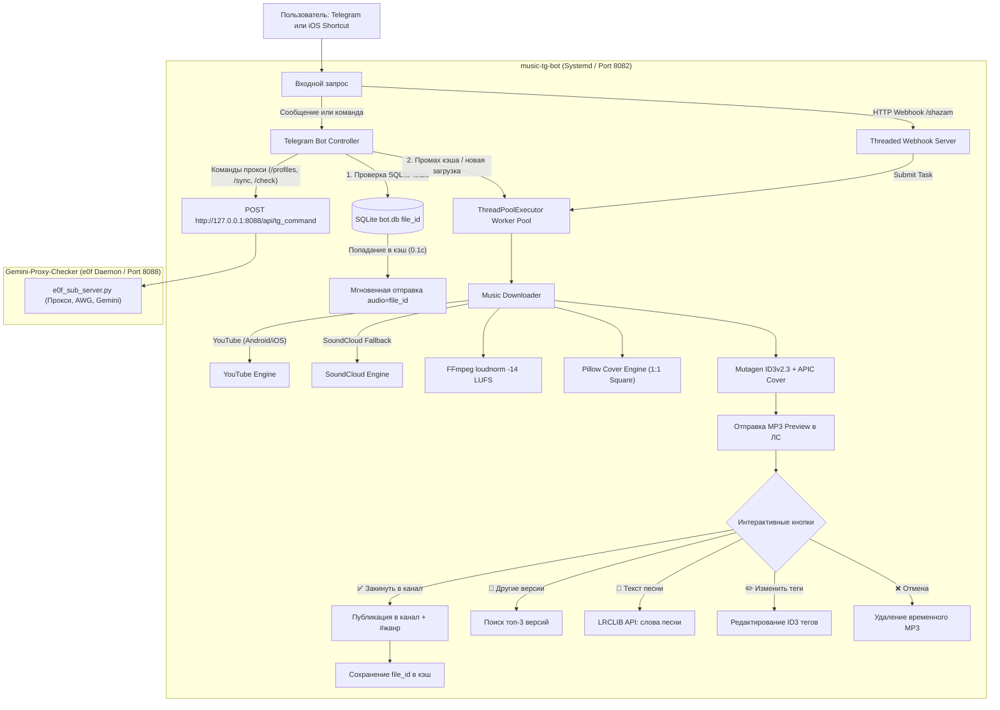

# 🎵 Telegram Music Bot & Downloader 2.0

[](https://www.python.org/downloads/)
[](https://github.com/yt-dlp/yt-dlp)
[](https://python-pillow.org/)
[](LICENSE)

Модульный, высокопроизводительный Telegram-бот для поиска, нормализации звука, скачивания музыки в высоком качестве (MP3 320 kbps) и автоматической публикации в Telegram-канал. Включает обход блокировок YouTube (HTTP 403 / 18+ Age Gate), мгновенный кэш `file_id` в SQLite (0.1 сек), 100% возврат квадратных обложек треков (Pillow + ID3 APIC), нормализацию громкости (EBU R128), слова песен, выбор альтернативных версий и Webhook API для **Apple Быстрых команд (Shazam)**.

---

## ✨ Основные возможности 2.0

1. **⚡ Мгновенная отправка из кэша (0.1 сек)**:
   - Встроенная SQLite база данных `data/bot.db` сохраняет `file_id` Telegram всех отправленных и опубликованных треков.
   - При повторном запросе трека он отдается мгновенно без повторного скачивания с YouTube/SoundCloud.
2. **🖼 100% восстановление обложек треков (Cover Art Engine)**:
   - Автоматический перехват обложек любого формата (`.webp`, `.jpg`, `.png`, `.jfif`) из YouTube и SoundCloud.
   - Квадратный центрированный кроп 1:1 с помощью **Pillow**:
     - `cover.jpg` (600x600, JPEG 92%) — вшивается в ID3v2.3 `APIC` фрейм MP3 (отображается в плеере iOS, Android, macOS и Telegram Desktop).
     - `thumb.jpg` (320x320, JPEG <200 КБ) — передается как Telegram `thumbnail` для красивой превью-карточки трека в сообщении.
3. **🔊 Автоматическая нормализация громкости (EBU R128)**:
   - Аудиофильтр FFmpeg `loudnorm=I=-14:TP=-1.5:LRA=11` приводит все треки к единому стандарту стриминговых сервисов (-14 LUFS). Никаких оглушающих или чересчур тихих треков.
4. **🔀 Выбор альтернативных версий (`🔀 Другие версии`)**:
   - Кнопка под предпросмотром находит топ-3 альтернативных версии на YouTube (Remix, Live, Acoustic, Extended) и позволяет скачать любую из них в один клик.
5. **📝 Текст песни (`📝 Текст песни` / `/lyrics`)**:
   - Мгновенное получение текста песни из открытой базы LRCLIB API с выводом слов прямо в чат Telegram.
6. **🏷 Умные хэштеги жанров**:
   - Определение жанра через iTunes Search API с автоматическим добавлением тематических тегов (`#музыка #hiphop #rap`, `#rock`, `#electronic`, `#pop` и др.) в публикации канала.
7. **✏️ Редактирование тегов на лету (`✏️ Изменить теги`)**:
   - Возможность исправить исполнителя и название трека перед отправкой в канал. Бот перезаписывает ID3-теги файла через mutagen.
8. **🔗 Распознавание прямых ссылок**:
   - Поддержка ссылок на треки из **Spotify**, **Яндекс Музыки**, **Apple Music**, **SoundCloud** и **YouTube**.
9. **📂 Пакетное скачивание альбомов и плейлистов (`/album <link>`)**:
   - Извлечение треков из плейлистов YouTube и пакетная загрузка в очередь.
10. **🛡 Обход блокировок и 18+ YouTube**:
    - Использование клиентов Android и iOS в `yt-dlp`, предотвращающее `HTTP 403 Forbidden` и обходящее `Sign in to confirm your age` без экспорта cookies браузера.
    - Автоматический фоллбэк на SoundCloud при блокировках.
11. **⚡ Неблокирующая архитектура (`ThreadPoolExecutor`)**:
    - Загрузки и конвертации выполняются в пуле фоновых потоков; бот и вебхук мгновенно реагируют на любые действия.
12. **📱 Интеграция с Apple Командами (Shazam Webhook)**:
    - HTTP Webhook сервер (`/shazam` и `/music`, `GET`/`POST`) с авторизацией по токену для отправки треков с iPhone в один тап.
13. **🌐 Единый роутер команд (Интеграция с Gemini Proxy Checker)**:
    - Бесшовное объединение управления подписками Shadowrocket (`/profiles`, `/newprofile`, `/delprofile`, `/sync`, `/check`) и музыкой в одном Telegram-боте без конфликтов `409 Conflict`.
    - Объединенный статус серверов и очередей (`/status`) и раздельный статус музыки (`/mstatus`).

---

## 🕹 Команды Telegram-бота

| Команда | Описание | Модуль |
| :--- | :--- | :--- |
| `/status` | Единый статус: ноды Gemini Checker, таймер крон-проверки, подписки + воркеры музыки и кэш | **Единый** |
| `/mstatus` | Детальный статус исключительно музыкального сервиса | **Музыка** |
| `/profiles` (`/list`) | Список всех активных профилей и ссылок подписок Shadowrocket | **Прокси** |
| `/newprofile <имя>` | Создать новый профиль подписки с выделением серверов на e0f.cx | **Прокси** |
| `/delprofile <имя>` | Удалить профиль и освободить слоты на e0f.cx | **Прокси** |
| `/sync` | Принудительная синхронизация нод и протоколов с e0f API | **Прокси** |
| `/check` | Запуск полного цикла тестирования доступности Gemini (Web + API) | **Прокси** |
| `/music <название>` | Поиск и скачивание трека (MP3 320 kbps, обложка 1:1, EBU R128) | **Музыка** |
| `/album <ссылка>` | Пакетный парсинг и загрузка плейлиста или альбома YouTube | **Музыка** |
| `/lyrics <трек>` | Поиск и отображение текста песни из LRCLIB | **Музыка** |
| `/help` | Вызов интерактивной справки по всем разделам | **Единый** |

---

## 🏗 Архитектура



---

## 📁 Структура проекта

```
music-tg-bot/
├── config.py           # Загрузка и строгая типизация переменных окружения (.env)
├── database.py         # SQLite кэш file_id для мгновенного 0.1с ответа
├── downloader.py       # Движок загрузки, обход 403/18+, Pillow обложки, EBU R128, жанры, тексты
├── bot.py              # Контроллер Telegram бота, кнопки предпросмотра, версий, текстов, тегов
├── webhook.py          # HTTP Webhook сервер для Apple Shortcuts (/shazam, /music)
├── main.py             # Точка входа: graceful shutdown, инициализация сервиса
├── requirements.txt    # Зависимости Python (yt-dlp, mutagen, Pillow, requests, etc.)
├── .env.example        # Пример конфигурационного файла (с тестовыми данными)
├── .gitignore          # Исключение .env, временных аудиофайлов, bot.db и кэша
└── tests/
    └── test_music_bot.py # 22 юнит-теста: кэш, обложки, нормализация, ссылки, вебхуки
```

---

## 🚀 Установка и запуск

### 1. Клонирование и виртуальное окружение

```bash
git clone https://github.com/teddyxanya/music-tg-bot.git /opt/music-tg-bot
cd /opt/music-tg-bot

python3 -m venv venv
source venv/bin/activate
pip install -r requirements.txt
```

### 2. Конфигурация `.env`

Создайте боевой файл `.env` (права `chmod 600 .env`):

```env
TELEGRAM_BOT_TOKEN="ВАШ_ТОКЕН_БОТА"
MUSIC_CHANNEL_ID="-100XXXXXXXXXX"
MUSIC_OWNER_ID="ВАШ_TELEGRAM_ID"
SHAZAM_WEBHOOK_SECRET="СЕКРЕТНЫЙ_ТОКЕН_ДЛЯ_APPLE_SHORTCUTS"
MUSIC_WEBHOOK_PORT=8082
DOWNLOAD_DIR="/opt/music-tg-bot/downloads"
MAX_WORKERS=4
```

> ⚠️ **Безопасность:** реальные токены и ID хранятся **только на сервере** в `.env`. В репозитории на GitHub находится исключительно `.env.example` с тестовыми данными-заглушками.

### 3. Запуск юнит-тестов

```bash
python -m unittest tests/test_music_bot.py -v
```

### 4. Автозапуск через Systemd

Создайте сервис `/etc/systemd/system/music-bot.service`:

```ini
[Unit]
Description=Telegram Music Bot and Downloader Service
After=network.target

[Service]
Type=simple
User=root
WorkingDirectory=/opt/music-tg-bot
ExecStart=/opt/music-tg-bot/venv/bin/python main.py
Restart=always
RestartSec=5
StandardOutput=journal
StandardError=journal

[Install]
WantedBy=multi-user.target
```

Активируйте и запустите службу:

```bash
systemctl daemon-reload
systemctl enable music-bot
systemctl restart music-bot
systemctl status music-bot
```

---

## 📲 Настройка Apple Быстрой команды (iOS Shazam)

Для отправки распознанного трека из Shazam прямо в бота:

1. Откройте приложение **Команды (Shortcuts)** на iPhone.
2. Создайте новую команду:
   - Действие 1: **Распознать через Shazam**.
   - Действие 2: **Получить содержимое URL**:
     - URL: `https://YOUR_VPS_IP:8081/shazam` (или проксированный порт через Nginx)
     - Метод: `POST`
     - Заголовки: `Content-Type: application/json`
     - Тело запроса (JSON):
       ```json
       {
         "token": "ВАШ_SHAZAM_WEBHOOK_SECRET",
         "artist": "Исполнитель (из Shazam)",
         "title": "Название (из Shazam)"
       }
       ```
3. Назначьте команду на кнопку действия, виджет или касание задней панели iPhone.

---

## 📄 Лицензия

Распространяется под лицензией MIT. Подробности в файле [LICENSE](LICENSE).
